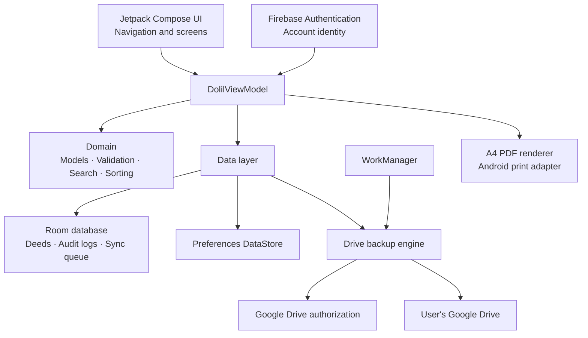

<!--
  Public documentation for the current repository implementation.
  Keep product claims aligned with app/build.gradle.kts and app/src/main/.
-->

<p align="center">
  
</p>

<h1 align="center">Dolil Onusondhan</h1>
<p align="center"><strong>দলিল অনুসন্ধান</strong></p>
<p align="center">
  A bilingual, offline-first workspace for organizing, managing, and finding land-deed information in Bangladesh.
</p>

<p align="center">
  <a href="https://github.com/jubayerhossaindev/dolil-onushondan/actions/workflows/android-ci.yml">
    
  </a>
  <a href="https://github.com/jubayerhossaindev/dolil-onushondan/releases/latest">
    
  </a>
  <a href="LICENSE">
    
  </a>
  
  
</p>

<p align="center">
  <a href="#features">Features</a> ·
  <a href="#design-language">Design</a> ·
  <a href="#architecture">Architecture</a> ·
  <a href="#getting-started">Get started</a> ·
  <a href="#testing">Testing</a> ·
  <a href="#releases">Releases</a> ·
  <a href="#community">Community</a>
</p>

---

## Overview

**Dolil Onusondhan** is a native Android application for recording and organizing land-deed information. It brings deed details, parties, land parcels, location references, search, record history, and printable summaries into one bilingual workspace.

The application is designed around local-first data entry: records and drafts are stored on the device, while signed-in users can connect a personal Google Drive account for backup and synchronization.

> **Important:** Dolil Onusondhan is an information-management tool. It is not a government land-record portal, does not certify ownership, and does not replace a certified deed or an official record search. Verify legal and ownership information with the appropriate Sub-Registry Office or AC Land Office.

## At a glance

| | |
|---|---|
| Product | Dolil Onusondhan (দলিল অনুসন্ধান) |
| Platform | Native Android |
| Application ID | `com.dolil.onushodan` |
| Current app version | `1.0.0` |
| Minimum Android version | Android 7.0 — API 24 |
| Target / Compile SDK | API 36 / API 36.1 |
| Primary language | Kotlin |
| UI toolkit | Jetpack Compose + Material 3 |
| Local persistence | Room + Preferences DataStore |
| Account identity | Firebase Authentication |
| Optional backup / sync | User-authorized Google Drive |
| License | [MIT License](LICENSE) |

## Features

### Deed records and data entry

- 📝 **Guided deed entry:** A five-step form for general deed information, grantors, grantees, location, and land parcels.
- 👥 **Multiple parties:** Record multiple grantors and grantees for a deed.
- 🗺️ **Land details:** Keep district, upazila, mouza, survey, dag, khatian, and parcel information together.
- 📐 **Land-area conversion:** Work with Decimal / Shotok, Katha, Bigha, Acre, and square feet.
- 💾 **Drafts and record lifecycle:** Save unfinished work, review records, archive eligible records, and restore them where permitted.
- 🧾 **Audit history:** Keep a record-level history of supported create, update, submit, approve, archive, and restore actions.

### Search and organization

- 🔎 **Bangla and English search:** Search by deed number, person name, dag, khatian, or mouza.
- 🔢 **Bengali digit normalization:** Bengali numerals (for example, `১২৫৬`) are normalized for consistent search and validation.
- 🧭 **Filters and sorting:** Filter deed records and choose from ten deterministic sorting options.
- 📚 **Directories:** Browse grantor/grantee information and saved land parcels.
- 📍 **Narayanganj location catalogue:** Use the bundled catalogue containing 99 deduplicated mouzas and JL numbers.

### Local-first storage and backup

- 📱 **Offline drafts:** Work with local records without requiring a live cloud database connection.
- 🧪 **Guest sandbox:** Explore sample records in a separate guest database, isolated from a signed-in user's database.
- ☁️ **Personal Google Drive backup:** Connect a Google Drive account and manage backup/synchronization from Settings.
- 🔄 **Background synchronization:** WorkManager schedules eligible background sync work and reports when renewed authorization is needed.
- 🔐 **Optional backup encryption:** Passphrase-based backup encryption uses AES-256-GCM with PBKDF2-HMAC-SHA256 key derivation.

### Documents and accessibility

- 🖨️ **A4 PDF and printing:** Generate a paginated deed summary and use Android's native print flow.
- 🌗 **Theme choices:** Select Light, Dark, or System theme; Dynamic Color can be enabled on compatible Android versions.
- 🌐 **Bilingual interface:** Switch between বাংলা and English.
- ♿ **Accessible controls:** Shared components provide semantic labels and a 48 dp minimum interactive target.

## Design language

The application uses its established **Paper & Ink** visual identity. It takes cues from paper documents and ink annotations rather than introducing a separate README-only brand system.

| Design token | Value | Role |
|---|---:|---|
| Warm Ivory | `#F6F0DF` | Light-mode background |
| Ink Navy | `#27364B` | Primary actions and emphasis |
| Warm Umber | `#735A32` | Secondary emphasis |
| Antique Gold | `#C69A45` | Restrained accent |
| Deep Charcoal | `#171A1D` | Dark-mode background |
| Dark Surface | `#24292D` | Dark-mode content surface |

**Typography** is bundled locally so the interface does not depend on downloading fonts at runtime:

- **Hind Siliguri** — Bengali-friendly headings and display text.
- **Noto Sans Bengali** — Bengali text.
- **Plus Jakarta Sans** — Latin text and numeric emphasis.

The design system centralizes spacing, corner radii, elevation, icon sizes, status colors, typography, and reusable Material 3 components. Light and dark themes use separate semantic color tokens; deed-document previews retain their parchment surface independently of the app theme.

## Preview and screenshots

The repository includes an application launcher icon and onboarding artwork, but it does **not** currently contain captured screenshots of the running application. For that reason, this README does not present illustrations as screenshots or use fabricated UI previews.

To add a screenshot gallery later, capture real screens from a running build and commit the images under a dedicated documentation asset directory.

## Technology stack

| Area | Current implementation |
|---|---|
| Language | Kotlin 2.4.21 |
| Android build | Android Gradle Plugin 9.1.1, Gradle Wrapper 9.3.1 |
| UI | Jetpack Compose, Material 3, Navigation Compose |
| App architecture | Single Activity, MVVM-style ViewModel, domain and data packages |
| Local database | Room 2.7.0 |
| Preferences | Jetpack Preferences DataStore 1.1.7 |
| Async work | Kotlin Coroutines 1.10.2, WorkManager 2.10.1 |
| Authentication | Firebase Authentication, AndroidX Credential Manager, Google Identity |
| Drive integration | Google Play Services AuthorizationClient and Google Drive API v3 client |
| Serialization / HTTP | Kotlinx Serialization, Moshi, OkHttp |
| Document output | Android PdfDocument, PrintManager, Storage Access Framework |
| Android tests | JUnit 4, Robolectric, Compose UI Test, Espresso |
| Companion data pipeline | Python 3.11+, httpx, Beautiful Soup, pandas, Pydantic, pytest |

**Backend boundary:** Firebase is used for authentication and account identity. The current application data path uses Room for local persistence and the user's authorized Google Drive for optional backup/synchronization. Firestore is not part of the current app data implementation.

## Architecture

The application keeps UI, domain rules, device persistence, external account integration, and document output in separate packages.



### Main responsibilities

| Package | Responsibility |
|---|---|
| `core/designsystem` | Paper & Ink tokens, typography, themes, strings, icons, and reusable UI components |
| `core/security` | Firebase authentication helpers, credential readiness, and role-permission checks |
| `core/print` | Deed document models, PDF rendering, and Android print adapter |
| `data/local` | Room database, DAO, entities, user preferences, device identity, and bundled location catalogue |
| `data/repository` | Local deed persistence and record lifecycle operations |
| `data/drive` | Drive authorization, backup engine, API client, backup models, and optional encryption |
| `data/sync` | WorkManager-based background Drive synchronization |
| `domain` | Deed models, enums, Bengali/English search normalization, sorting, and validation |
| `ui` | App navigation, ViewModel, screens, onboarding, and product-tour overlay |

### Data and account boundaries

- Signed-in users' local records are partitioned by account identifier in Room.
- Guest exploration uses a separate database file and seeded demo records.
- Firebase Authentication handles sign-in and account identity; it is not the deed-record database.
- Google Drive access is separately authorized by the user. Disconnecting Drive and revoking Google access are distinct actions in the application.
- Backup encryption is optional. A user who enables passphrase encryption must retain that passphrase to restore the encrypted backup.

> **Documentation drift:** Some older files under `docs/`, `qa-report/`, and the root `metadata.json` still describe an earlier Firestore/Gemini-based design. Those descriptions do not match the current Gradle dependencies and source tree. This README follows the current implementation: Room for local records, Firebase Authentication for identity, and optional personal Google Drive backup/synchronization. The older documents should be reconciled separately.

## Project structure

The following is a focused view of the current repository:

```text
dolil-onushondan/
├── .github/
│   └── workflows/
│       ├── android-ci.yml
│       └── android-release.yml
├── app/
│   └── src/
│       ├── main/
│       │   ├── assets/
│       │   │   └── narayanganj_locations.json
│       │   ├── java/com/example/
│       │   │   ├── core/
│       │   │   │   ├── designsystem/
│       │   │   │   ├── print/
│       │   │   │   └── security/
│       │   │   ├── data/
│       │   │   │   ├── drive/
│       │   │   │   ├── local/
│       │   │   │   ├── repository/
│       │   │   │   └── sync/
│       │   │   ├── domain/
│       │   │   │   ├── model/
│       │   │   │   ├── search/
│       │   │   │   └── validation/
│       │   │   └── ui/
│       │   │       └── screens/
│       │   └── res/
│       │       ├── drawable/
│       │       ├── font/
│       │       ├── mipmap-*/
│       │       ├── values-bn/
│       │       └── values-en/
│       ├── test/
│       └── androidTest/
├── docs/
├── narayanganj_land_pipeline/
│   ├── src/narayanganj_pipeline/
│   ├── tests/
│   └── output/
├── qa-report/
├── gradle/
├── build.gradle.kts
├── settings.gradle.kts
├── gradle.properties
├── gradlew
├── gradlew.bat
└── README.md
```

## Requirements

### Android application

| Requirement | Version / value |
|---|---|
| Operating system | Windows, macOS, or Linux development host supported by Android Studio |
| JDK | 21 (used by the repository's GitHub Actions workflows) |
| Android SDK | API 36 / extension level 36.1 for compilation |
| Minimum device OS | Android 7.0 (API 24) |
| Gradle | 9.3.1, supplied by the Gradle Wrapper |
| Android Gradle Plugin | 9.1.1 |
| Kotlin | 2.4.21 |

Use Android Studio with the Android SDK components required by the project. The Gradle Wrapper is included; a separate system Gradle installation is not required.

### Companion Python pipeline

The optional Narayanganj land-geographic metadata pipeline requires **Python 3.11 or newer**. Its Python dependencies are installed separately from the Android project.

## Getting started

### 1. Clone the repository

```bash
git clone https://github.com/jubayerhossaindev/dolil-onushondan.git
cd dolil-onushondan
```

### 2. Prepare the Android build environment

Install JDK 21 and the Android SDK required by the project. Open the repository in Android Studio and allow the Gradle project to sync.

The debug build configuration references a root-level `debug.keystore`. Generate a local development key if one is not already present:

```bash
keytool -genkeypair -v \
  -keystore debug.keystore \
  -storepass android \
  -alias androiddebugkey \
  -keypass android \
  -keyalg RSA \
  -keysize 2048 \
  -validity 10000 \
  -dname "CN=Android Debug,O=Android,C=US"
```

For Windows Command Prompt, use `gradlew.bat` in place of `./gradlew` in the commands below.

### 3. Configure authentication and Google Drive

The repository intentionally does not include a production Firebase configuration or a production signing key.

1. Register an Android app in Firebase using the current application ID: `com.dolil.onushodan`.
2. Enable the authentication providers required by your deployment (Email/Password and Google are implemented in the app).
3. Download the matching `google-services.json` and place it at `app/google-services.json`.
4. Register the relevant debug and release signing fingerprints with the Firebase / Google Cloud project.
5. To use Drive backup, enable the Google Drive API and configure the OAuth consent screen and required account scopes in the associated Google Cloud project.

Do not commit production credentials, OAuth client secrets, release keystores, or signing passwords. The Drive integration uses native Android authorization; a Google OAuth client secret must not be embedded in the APK or source code.

The Google Services Gradle plugin is configured to warn when the local Firebase configuration file is missing, which allows some non-authentication development tasks to proceed. Actual sign-in and connected Drive operations still require valid external configuration.

### 4. Build the debug application

```bash
./gradlew :app:assembleDebug
```

The generated APK is located at:

```text
app/build/outputs/apk/debug/app-debug.apk
```

## Usage

1. Launch **Dolil Onusondhan** and choose বাংলা or English during onboarding.
2. Continue with Google sign-in or explore the isolated Guest Mode.
3. Use **Add Deed** to enter deed details through the guided five-step form.
4. Open **Search** to find records by deed number, party name, dag, khatian, or mouza.
5. Use **Records** to review available drafts and saved records, then open a record for its details and permitted actions.
6. Open **Profile / Settings** to change language and theme, manage account settings, and configure Google Drive backup.

For official verification, consult the relevant government land and registration office. The application organizes information entered by its users; it does not independently certify that information.

## Testing

Run the Android checks from the repository root:

```bash
./gradlew lintDebug testDebugUnitTest assembleDebug
```

The test source sets include:

- **Domain tests:** search normalization, Bengali digit handling, deed validation, sorting, and role-permission rules.
- **Room and repository tests:** local persistence, draft handling, audit entries, sync queue behavior, and conflict-resolution logic.
- **Compose / Robolectric tests:** screen flows, form validation, dialogs, navigation, and UI states.
- **Instrumented test source set:** Android instrumentation test configuration.

### GitHub Actions

| Workflow | Trigger | Checks / output |
|---|---|---|
| [Android CI](.github/workflows/android-ci.yml) | Pull requests targeting `main`; manual workflow dispatch | Debug lint, JVM/Robolectric unit tests, debug APK build, and uploaded reports |
| [Android Release](.github/workflows/android-release.yml) | Version tag matching `v*` | Tag/version validation, release lint, signed APK and AAB builds, artifact verification, and GitHub Release publication |

The latest audited Android CI run and the `v1.0.0` release workflow both completed successfully. Headless CI cannot replace every real-device check: interactive Google consent, connected multi-device Drive behavior, and Android system print/save dialogs should still be smoke-tested on supported devices before a wider production rollout.

## Companion tool: Narayanganj land pipeline

The repository also contains a separate Python tool under `narayanganj_land_pipeline/`. It collects, normalizes, stores, and verifies publicly exposed land-geographic metadata for Narayanganj District. It is not required to build or run the Android application.

### Data collection guardrails

- Checks source access policies and robots directives before collection.
- Stops when a source returns an access-denied response such as HTTP 403; it does not attempt to bypass blocks.
- Excludes personal and sensitive owner information and does not call Khatian/owner endpoints.
- Collects public map-directory metadata without downloading map binaries.
- Keeps verified and unverified results separate rather than inventing missing data.

### Setup and commands

```bash
cd narayanganj_land_pipeline
python -m venv .venv
python -m pip install -r requirements.txt

# Run the pipeline test suite
PYTHONPATH=src python -m pytest -v

# Collect, normalize, verify, and export available public metadata
PYTHONPATH=src python -m narayanganj_pipeline.cli run --max-map-depth 3

# Re-verify an existing SQLite database and regenerate reports
PYTHONPATH=src python -m narayanganj_pipeline.cli verify
```

On Windows Command Prompt, set the source path before running Python commands:

```bat
set PYTHONPATH=src
python -m pytest -v
python -m narayanganj_pipeline.cli run --max-map-depth 3
```

See the [pipeline-specific README](narayanganj_land_pipeline/README.md) for its detailed setup and output description.

## Releases

The current published release is **v1.0.0**.

- [Download the APK](https://github.com/jubayerhossaindev/dolil-onushondan/releases/download/v1.0.0/app-release.apk)
- [Download the Android App Bundle (AAB)](https://github.com/jubayerhossaindev/dolil-onushondan/releases/download/v1.0.0/app-release.aab)
- [View release notes and checksums](https://github.com/jubayerhossaindev/dolil-onushondan/releases/tag/v1.0.0)
- [Browse all releases](https://github.com/jubayerhossaindev/dolil-onushondan/releases)

To publish a new release, the repository's release workflow expects a semantic version tag (for example, `v1.0.1`) matching the app's `versionName`, plus the signing and Firebase configuration secrets documented in the workflow.

## Community

Dolil Onusondhan is an open-source project. These documents explain how to participate, how community members are expected to treat one another, and how to report security concerns.

<p align="center">
  <a href="CODE_OF_CONDUCT.md">Code of Conduct</a> ·
  <a href="CONTRIBUTING.md">Contributing Guide</a> ·
  <a href="SECURITY.md">Security Policy</a> ·
  <a href="LICENSE">MIT License</a>
</p>

### Code of Conduct

We aim to keep project discussions welcoming, respectful, and constructive. Please read the [Code of Conduct](CODE_OF_CONDUCT.md) before participating in issues, reviews, or contributions.

### Contributing

Bug reports, focused fixes, documentation improvements, tests, accessibility work, and scoped features are welcome. Start with the [contribution guide](CONTRIBUTING.md), and open an [issue](https://github.com/jubayerhossaindev/dolil-onushondan/issues) before beginning a substantial change.

### Security

Do not publish vulnerabilities, credentials, private deed information, or access tokens in public issues. Read the [Security Policy](SECURITY.md) for private reporting instructions and safe-testing boundaries.

### License

The `jubayerhossaindev/dolil-onushondan` repository is licensed under the **MIT License**.

Copyright (c) 2026 **Dolil Onushodan**.

The MIT License is a short, permissive open-source license. It allows the licensed work, modifications, and larger works to be distributed under different terms, including without publishing their source code, provided the required copyright and license notices are preserved.

**Permissions**

- Commercial use
- Modification
- Distribution
- Private use

**Limitations**

- Liability
- Warranty

**Condition**

- The original copyright and license notice must be included in copies or substantial portions of the software.

See the complete [MIT License](LICENSE) for the legally operative terms.

## Support

- 🐛 [Report a bug or request a feature](https://github.com/jubayerhossaindev/dolil-onushondan/issues)
- 🔀 [Browse pull requests](https://github.com/jubayerhossaindev/dolil-onushondan/pulls)
- 📦 [Download the latest release](https://github.com/jubayerhossaindev/dolil-onushondan/releases/latest)

---

<p align="center">
  Made for clearer, more organized land-deed information in Bangladesh.
  <br />
  <a href="https://github.com/jubayerhossaindev/dolil-onushondan">Dolil Onusondhan on GitHub</a>
</p>
